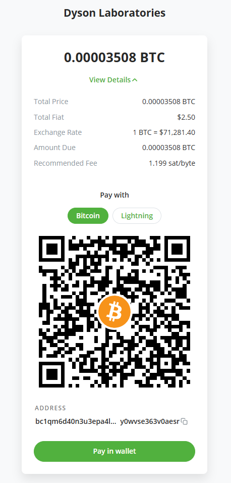

# gf-sdk Historical Partner-SDK Donor

> **Donor status:** This repository is not an Operational Marketplace V1
> runtime or integration dependency. Its TypeScript client, examples, target
> modes, and tests may be adapted in `space-marketplace`; canonical Portal
> source belongs in `ops-btcpay-realnet`. Revalidate every endpoint and
> contract before reuse. The examples below are historical and do not authorize
> invoice creation or production access.

## Before you start
If you haven't yet reached out to Dyson Sphere Laboratories
and gotten access to the SCRAP specification, you can do so
by emailing calvin@dyson-labs.com or filling out the form here:
https://www.dyson-labs.com/contact

## What this looks like in practice



**Example BTCPay invoice created via `gf-sdk`.**  
USD-denominated invoice created programmatically, with settlement verified by the SCRAP portal.

## Documentation

Most user-facing documentation for the SDK lives under:

- [SDK Documentation](packages/gf-sdk/docs)

Key guides:
- [Treasury & Conversion Guide](packages/gf-sdk/docs/treasury-conversion-guide/README.md)


# gf-sdk Monorepo

Historical example: `examples/create-invoice/example.ts` demonstrates the
legacy Portal client. Do not run it against a live endpoint without an
explicitly authorized payment test.

The historical connected integration targeted the remote SCRAP Portal. Future
local/enclave Portal targets and offline bundle targets are documented in
`packages/gf-sdk/docs/target-modes/README.md`; do not assume local Portal
execution unless an operator supplies an explicit local or enclave endpoint.
The recorded production example used baseUrl
`https://btcpay.dyson-labs.com` with apiPrefix `/portal`.
Integration tests require `GF_PORTAL_BASE_URL` and will skip unless it is set.
`/portal-staging` is not currently exposed; staging is TBD unless explicitly provided.

Historical environment example (revalidate before use):

```text
GF_PORTAL_BASE_URL=https://btcpay.dyson-labs.com
GF_PORTAL_API_PREFIX=/portal
GF_PORTAL_V1_PREFIX=/v1
```

`PORTAL_ADMIN_TOKEN` is only required for admin-only dispatch and legacy exec.

This repo is split into two packages:

- `packages/gf-sdk` � public SCRAP Portal SDK for integrators (PortalClient only)
- `packages/gf-tools` � internal tooling and simulation helpers (BTCPay-direct, dev scripts)

## Workspace commands

```
pnpm install
pnpm build
pnpm test
pnpm lint
```

## Package commands

```
pnpm -C packages/gf-sdk build
pnpm -C packages/gf-sdk portal:health
pnpm -C packages/gf-sdk smoke

pnpm -C examples/create-invoice start
```

## Migration note

If you previously used BTCPay-direct helpers from `gf-sdk`, they have moved to `packages/gf-tools`.
The public SDK now targets the SCRAP Portal only.
